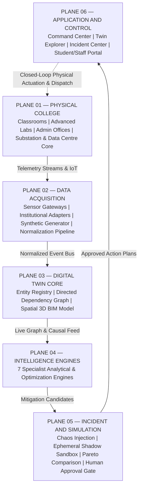

# OMNIS-X — Institutional Digital Twin Master Architecture
## Layered Isometric Blueprint Visualization Specification

---

### 1. Executive Summary & Visual Reference Translation

The **OMNIS-X Master Architecture Diagram** has been redesigned to reflect the visual language, spatial depth, and technical drafting aesthetic of the reference blueprint.

#### Visual Reference Translation Matrix

| Reference Characteristic | Reference Principle | OMNIS-X Implementation |
| :--- | :--- | :--- |
| **Perspective Geometry** | Layered planes suspended in 2.5D axonometric space | **6 Layered Architectural Slabs** (`PLANE 01` to `PLANE 06`) with trapezoidal perspective slant, corner extrusion thickness (16px), and floor wireframe grids. |
| **Spatial Separation & Alignment** | Dashed vertical drop-lines linking plane boundaries | **Continuous 4-Corner Drop Lines** (`stroke-dasharray="5,5"`) anchoring all six planes into a unified isometric coordinate chamber. |
| **Linework & Contrast** | Fine white vector lines on dark drafting background | **Deep Navy/Charcoal `#0B111A` Background** with 40px fine and 200px major engineering grids, 0.8px–1.5px white (`#ffffff`) and slate outlines. |
| **Information Hierarchy** | Orbital cycles, clear node cards, technical tags | **Dedicated Subsystem Modules** with window bars, status LEDs, monospace telemetry codes, and bracketed badges (`[APP-01]`, `[CORE-02]`, `[ING-03]`). |
| **Causal Data Routing** | Accent-colored connectors between planes | **Color-Coded Inter-Plane Conduits**: Electric Blue (Real Telemetry), Amber (Reported / Approval), Purple (Synthetic), Cyan (Estimated / Spatial), Teal (Twin State). |
| **Institutional Governance** | Cross-cutting vertical control flow | **Continuous Vertical Security & Governance Spine** on the left with lateral bus conduits tapping into each plane. |

---

### 2. Six Required Architectural Planes

---

#### Detailed Plane Breakdown

#### **PLANE 01 — PHYSICAL COLLEGE (Physical Ground)**
- **Miniature Campus Blueprint**:
  - **Academic Wing**: 8 Classrooms (`CR-101` through `CR-108`) with desk rows, occupancy sensors, and smart projectors (`CR-104` highlighted as focal room); 2 Tiered Lecture Halls (`LH-01` Alpha and `LH-02` Beta, 180-seat capacity).
  - **3 Advanced Laboratories**:
    - `Lab 01`: High-Performance Computing Lab (60 workstations, Gigabit switch trunk).
    - `Lab 02`: AI, Autonomous Systems & Robotics Lab (**Focal Critical Facility**, GPU cluster, chiller loop, Modbus power telemetry).
    - `Lab 03`: Power Systems & High-Voltage Networks Lab (Smart grid testbed, motor-generator sets, direct substation connection).
  - **Administration & Faculty Hubs**: Dean's Suite, Registrar, Facilities Management & Security NOC, Faculty North & South Wings.
  - **Campus Utility Core**:
    - **Main Substation & Power Room**: 11kV grid ingress, step-down transformers, ATS, 500kVA diesel generator, N+1 modular UPS battery bank.
    - **Tier-III Data Centre**: Server racks `R01`–`R06`, in-row precision cooling, dual A/B power feeds, VESDA fire detection.
    - **Network & Connectivity**: MDF fiber core, IDF switch network across all wings, campus Wi-Fi 6 AP matrix, LoRaWAN gateway, 5G micro-cell.

#### **PLANE 02 — DATA ACQUISITION (Multi-Modal Ingress & Normalization)**
- **Four Distinct Telemetry Streams**:
  1. **Real Telemetry** (`#38bdf8`, Solid Electric Blue): IoT gateways (`GW-01`–`GW-08`), Modbus power meters, BACnet HVAC sensors.
  2. **Reported Data** (`#fb923c`, Amber Dotted): SAP/Oracle ERP work order adapter, SIS timetable/exam calendar sync, student/staff mobile PWA trouble ingress.
  3. **Synthetic Telemetry** (`#c084fc`, Purple Dashed): Synthetic stress telemetry generator, virtual 10,000-node simulator, counterfactual noise injector.
  4. **Estimated State** (`#2dd4bf`, Cyan Fine Dashed): Missing sensor Kalman filter imputation, virtual thermodynamic flow physics.
- **Processing Core `[PIPE-01]`**:
  - Schema validation (JSON-Schema type checking, bounds checking, 99.98% clean pass rate).
  - Normalization engine (SI unit conversion, epoch UTC timestamp sync, clock drift correction).
  - Provenance binding (cryptographic provenance header stamped on every packet).

#### **PLANE 03 — DIGITAL TWIN CORE (Graph, Spatial & Operational State)**
- **`[CORE-01]` Entity Registry**: Canonical UUID master catalog, physical BIM/GIS coordinates, logical IP/circuit attributes, academic course/cohort bindings.
- **`[CORE-02]` Directed Dependency & Causal Topology Graph** (**Visually Prominent**):
  - Directed topological network with interactive-style circular and rectangular nodes:
    `Substation-A` $\rightarrow$ `UPS-MAIN` $\rightarrow$ `DataCentre` $\rightarrow$ `Lab L-2` $\rightarrow$ `CS-401 EXAM`
    `Substation-A` $\rightarrow$ `UPS-MAIN` $\rightarrow$ `MDF-CORE` $\rightarrow$ `Lab L-1` $\rightarrow$ `EE-202 LAB`
    `Substation-A` $\rightarrow$ `UPS-MAIN` $\rightarrow$ `MDF-CORE` $\rightarrow$ `CR-104`
  - Causal edge labels (`POWERS`, `STANDBY_FEED`, `SERVES_COMPUTE`, `NETWORK_TRUNK`, `HOSTS_EXAM`, `HOSTS_COURSE`).
- **`[CORE-03]` Spatial BIM & Operational State Engine**:
  - 3D BIM coordinate geometry engine (WGS-84 to local IFC mapping, R-Tree spatial index).
  - In-memory distributed state cache (14,000 ops/sec commit rate, point-in-time snapshotting).

#### **PLANE 04 — INTELLIGENCE ENGINES (7 Specialist Analytical Modules)**
Represented as seven distinct, interconnected algorithmic modules (not generic LLMs):
1. **`[01]` Event & Anomaly Detection**: Statistical Z-Score, Isolation Forest, dynamic threshold breach monitor.
2. **`[02]` Graph Impact Propagation**: BFS/DFS directed blast radius calculator, topological cascade traversal, upstream root-cause isolator.
3. **`[03]` Risk & Criticality Analysis**: Multi-factor FMEA vulnerability scoring, campus safety & critical asset weighting.
4. **`[04]` Academic & Resource Impact**: Classroom/exam timetable conflict matrix, curriculum loss & contact-hour displacement evaluator.
5. **`[05]` Recovery Optimization**: Mixed-Integer Linear Programming (MILP) & heuristic constraint solver for circuit rerouting.
6. **`[06]` Responsibility & Task Assignment**: RACI dispatch engine, duty officer assignment, SLA countdown timer.
7. **`[07]` Decision & Coordination**: Multi-Criteria Decision Analysis (MCDA), strategic consensus ranker, playbook coordinator.
- **Interconnect Bus**: High-throughput IPC / event mesh linking all engines with sequential and feedback channels.

#### **PLANE 05 — INCIDENT AND SIMULATION (Counterfactual Sandbox & Verification)**
- **Strict Visual Separation**:
  - **Zone A: Counterfactual Simulation Sandbox** (Dashed orange boundary):
    - *Failure Injection*: Chaos experiments (Substation breaker trip, core switch failure, chiller unit trip).
    - *Shadow-State Cascade*: Ephemeral twin instance (`SIM-BRANCH-88`) modeling secondary circuit overload, UPS battery curve, 14-room blast radius.
    - *Projected Impact Assessment*: Quantified downtime (~3.5 hrs unmitigated), 8 displaced lectures, 340 affected students.
  - **Zone B: Optimization, Comparison & Human Approval**:
    - *Alternative Recovery Plans*: Plan Alpha (Recommended, Bus-B reroute, 12 min downtime), Plan Beta (Virtual labs, 45 min), Plan Gamma (Load shedding, 90 min).
    - *Tradeoff Radar Comparison*: Six-axis Pareto polygon (Downtime vs Cost vs Safety vs Academic vs Risk vs Effort).
    - **Illuminated Amber Human Approval Gate**: `[GATEWAY: HUMAN APPROVAL REQUIRED]` with sign-off requirement by Director of Facilities & Dean of Operations.
    - *Task Execution & Closed-Loop Verification*: Work order dispatch #4109, automated breaker actuation, post-action telemetry verification confirming normal state.

#### **PLANE 06 — APPLICATION AND CONTROL (Operational Surfaces)**
- **`[APP-01]` Command Center**: Executive NOC/EOC console, Campus Health Index (99.42%), active alerts, telemetry wall.
- **`[APP-02]` Digital Twin Explorer**: Interactive 3D BIM/GIS canvas with wireframe buildings, room drill-down, live micro-climate sensor pinning.
- **`[APP-03]` Intelligence & Incident Center**: Active incident workbench (`INC-2026-081`), playbook runner, blast radius inspector.
- **`[APP-04]` Student / Staff Reporting Portal**: Citizen sensing mobile PWA, incident submission (photo + GPS), campus safety notification broadcast.

---

### 3. Cross-Cutting Security & Governance Spine

A vertical architectural pillar spanning all six tiers along the left margin ($x = 90$ to $390$, $y = 360$ to $3460$):
- **Level 06**: Interface RBAC, OAuth 2.0 / SAML SSO, Zero-Trust session guard, ABAC evaluation.
- **Level 05**: Human-in-the-Loop multi-signature mandate, chaos experiment containment boundary.
- **Level 04**: Algorithmic safety constraints, mathematical optimality proofs, explainability trails.
- **Level 03**: Graph tamper detection, canonical schema validation, Merkle-tree append-only audit ledger.
- **Level 02**: Hardware TPM/mTLS attestation, cryptographic stream taint (`IS_SYNTHETIC=TRUE`).
- **Level 01**: Physical hardware hardening, biometric access control, hardwired Emergency Power Off (EPO).

---

### 4. Deliverables & File Index

The generated assets are stored in `d:\parallax\OMNIS-X\OMNIS-X-Architecture\`:

1. **[OMNIS-X_Master_Architecture.html](file:///d:/parallax/OMNIS-X/OMNIS-X-Architecture/OMNIS-X_Master_Architecture.html)**  
   *Interactive self-contained presentation file embedding the complete SVG with web typography (`Geist`, `Geist Mono`), custom styles, and responsive zoom frame.*

2. **[OMNIS-X_Architecture_Source.svg](file:///d:/parallax/OMNIS-X/OMNIS-X-Architecture/OMNIS-X_Architecture_Source.svg)**  
   *Full-resolution standalone vector SVG ($2600 \times 3700$ px), containing all 6 planes, perspective drop-lines, 7 engines, and security pillar.*

3. **[OMNIS-X_Architecture_Preview.png](file:///d:/parallax/OMNIS-X/OMNIS-X-Architecture/OMNIS-X_Architecture_Preview.png)**  
   *High-resolution rasterized preview rendered directly via headless Chrome ($2600 \times 3800$ viewport).*

4. **[generate_isometric_architecture.py](file:///d:/parallax/OMNIS-X/OMNIS-X-Architecture/generate_isometric_architecture.py)**  
   *Complete, editable Python generator script allowing parametric modification of perspective geometry, coordinates, labels, and rendering parameters.*
