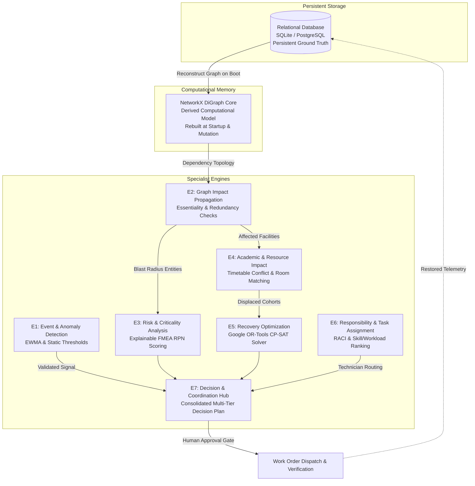

# OMNIS-X — Institutional Cyber-Physical Digital Twin & Resilience Backend

[](https://fastapi.tiangolo.com)
[](https://www.sqlalchemy.org/)
[](https://developers.google.com/optimization)
[](https://networkx.org/)
[](https://www.python.org/)
[](https://pytest.org/)

OMNIS-X is an institutional cyber-physical digital twin and resilience decision-support system. It represents university infrastructure as a unified cyber-physical system, connecting physical infrastructure, buildings, electrical distribution grids, IT network hardware, lab assets, academic timetables, human incident reporting, and departmental work order routing.

---

## 1. Architectural Foundation & Core Principles



### Critical Architectural Guarantees:
1. **Persistent Source of Truth vs. Derived In-Memory Graph:**
   - SQLite / PostgreSQL holds the durable source of truth (`entities`, `relationships`, `operational_states`, `state_history`, `telemetry_events`, `incidents`, `work_orders`, `approvals`, `simulations`, `audit_logs`).
   - NetworkX `DiGraph` is a derived computational in-memory representation. It is reconstructed from the database on boot and atomically updated whenever changes are committed.
2. **Deterministic Specialist Engines (Zero Autonomous LLM Hallucination):**
   - All seven intelligence modules are deterministic software algorithms adhering to typed Pydantic contracts.
3. **Explicit Graph Propagation Semantics:**
   - Edges have typed propagation semantics: `SUPPLIES_POWER_TO` propagates electrical outages, `CONNECTED_TO_NETWORK` propagates network dropouts, `USES_EQUIPMENT` and `ASSIGNED_TO_ROOM` disrupt academic activities.
   - `LOCATED_IN` and `CONTAINS` are structural/spatial context and **NEVER** propagate functional failure across rooms.
4. **Active Redundancy Evaluation:**
   - Downstream nodes with active backup paths (`BACKED_UP_BY`, secondary operational feeders, or UPS systems) are classified as `AT_RISK` rather than immediately failing.
5. **Layer 5 Shadow Simulation Isolation:**
   - Ephemeral counterfactual chaos experiments run on deep copies of the graph in memory and **NEVER** mutate live operational database records.

---

## 2. Seven Specialist Intelligence Engines

| Engine | Name | Algorithmic Core | Primary Function |
|---|---|---|---|
| **E1** | Event & Anomaly Detection | Statistical EWMA + Multi-Tier Static Thresholds + Sliding-Window Deduplication | Validates incoming telemetry, flags voltage drops, frequency spikes, and detects duplicate suppression within 300s window. |
| **E2** | Graph Impact Propagation | Breadth-First Dependency Traversal + Redundancy Path Checking | Evaluates directed downstream cascade from failed nodes; preserves non-essential and redundant links. |
| **E3** | Risk & Criticality Analysis | Explainable Failure Mode & Effects Analysis (FMEA) | Computes $\text{RPN} = \text{Severity} \times \text{Occurrence} \times \text{Detectability}$, normalized to $0.1 - 100.0$ scale. |
| **E4** | Academic & Resource Impact | Academic Timetable Correlation & Capacity Constraint Matrix | Identifies displaced students, affected course sections, and ranks candidate spare rooms by capacity and equipment. |
| **E5** | Recovery Optimization | Google OR-Tools CP-SAT (Constraint Programming) | Solves exact room reallocations ($X_{a, r}$) minimizing disruption and capacity waste; proves mathematical infeasibility when violated. |
| **E6** | Task & Assignment | Deterministic RACI Matrix + Technician Skill/Workload Scorer | Matches incident domain to department; ranks technicians on verified skills (+20), workload balance (-10/task), and availability. |
| **E7** | Decision & Coordination | Multi-Criteria Governance Evaluator | Compiles typed `IncidentDecisionPlan`, flags mandatory human approval gates (HOD for timetable, Facility Manager for high voltage). |

---

## 3. Demonstration Dataset & Seed Topology

The backend ships with an idempotent seed dataset modeling an engineering campus:
- **Buildings & Zones:** `CAMPUS-MAIN`, `BLDG-ENG` (4 floors: `FLOOR-G`, `FLOOR-1`, `FLOOR-2`).
- **Power Core:** `SUBSTATION-01` (11kV), `GEN-500KVA` (Diesel backup), `ATS-01`, `PANEL-ENG-MAIN`, `FEEDER-LABS-F1` (Supplies L1 Labs), `FEEDER-CR-F2` (Supplies L2 Classrooms).
- **Laboratories & Rooms:**
  - `LAB-01-EE`: Electronics Lab (40 cap, benches, oscilloscopes, DC supplies) — *Focal Lab (No Backup)*.
  - `LAB-02-ROBOTICS`: Autonomous Systems Lab (35 cap, GPU cluster, protected by `UPS-LAB-02` backup).
  - `CR-201` & `CR-202`: Smart Classrooms (60 cap, interactive projectors).
  - `LH-01`: Tiered Lecture Hall Alpha (150 cap).
- **Academic Activities:**
  - `ACT-EE301-LAB`: Microcontroller Lab, 32 students, scheduled in `LAB-01-EE` (Requires Oscilloscopes & DC supplies).
  - `ACT-AI401-LAB`: Robotics Lab, 28 students, scheduled in `LAB-02-ROBOTICS`.
  - `ACT-CS201-LEC`: Data Structures Lecture, 55 students, scheduled in `CR-201`.
- **Preconfigured Users:**
  - Principal: `principal` / `Password123!` (Role: `PRINCIPAL`)
  - Facility Manager: `facility_mgr` / `Password123!` (Role: `FACILITY_MANAGER`)
  - Electrical Lead: `elec_tech1` / `Password123!` (Role: `STAFF`)
  - ECE Department Head: `faculty_sharma` / `Password123!` (Role: `HOD`)
  - Enrolled Student: `student_priya` / `Password123!` (Role: `STUDENT`)

---

## 4. Windows PowerShell Setup & Execution Guide

### Prerequisites
- Python 3.11+ or Python 3.14+ (Installed on Windows)
- PowerShell 5.1 or PowerShell 7+

### Step-by-Step Commands

```powershell
# 1. Navigate to the project backend directory
cd D:\parallax\OMNIS-X\omnis-x

# 2. (Optional) Create and activate a virtual environment
python -m venv venv
.\venv\Scripts\Activate.ps1

# 3. Install core dependencies
pip install -r requirements.txt

# 4. Copy environment configuration
Copy-Item .env.example .env

# 5. Run the complete automated test suite (22 unit, engine, and integration tests)
pytest -v

# 6. Start the OMNIS-X backend server
uvicorn backend.main:app --host 0.0.0.0 --port 8000 --reload
```

---

## 5. Live Service URLs

Once started:
- **Base API URL:** `http://localhost:8000`
- **Interactive Swagger Documentation:** `http://localhost:8000/docs`
- **ReDoc Interactive Reference:** `http://localhost:8000/redoc`
- **OpenAPI JSON Contract:** `http://localhost:8000/openapi.json`
- **System Health Probe:** `http://localhost:8000/health`

---

## 6. End-to-End API Scenario Walkthrough (Power Failure in Electronics Lab)

Below are exact PowerShell examples demonstrating the complete closed-loop incident lifecycle.

### A. Authenticate as Executive
```powershell
$tokenResponse = Invoke-RestMethod -Method Post -Uri "http://localhost:8000/api/v1/auth/token" -ContentType "application/json" -Body '{"username":"principal","password":"Password123!"}'
$token = $tokenResponse.access_token
$headers = @{ "Authorization" = "Bearer $token" }
```

### B. Ingest Modbus Power Telemetry Breach (Engine 1)
```powershell
Invoke-RestMethod -Method Post -Uri "http://localhost:8000/api/v1/events" -Headers $headers -ContentType "application/json" -Body '{
    "event_id": "EVT-METER-F1-001",
    "entity_id": "METER-FEEDER-F1",
    "metric_name": "voltage_v",
    "value": 0.0,
    "source_type": "REAL"
}'
```

### C. Report Incident on Feeder F1
```powershell
$inc = Invoke-RestMethod -Method Post -Uri "http://localhost:8000/api/v1/incidents" -Headers $headers -ContentType "application/json" -Body '{
    "incident_id": "INC-2026-F1-TRIP",
    "title": "Feeder Bus F1 Electrical Power Loss",
    "description": "Zero voltage detected on Feeder F1 sub-distribution board. First floor lab wing power lost.",
    "root_entity_id": "FEEDER-LABS-F1",
    "priority": "HIGH",
    "source_type": "REAL"
}'
```

### D. Trigger Specialist Engines Analysis Pipeline (Engines 2–7)
```powershell
$plan = Invoke-RestMethod -Method Post -Uri "http://localhost:8000/api/v1/incidents/$($inc.incident_id)/analyze" -Headers $headers
# Inspect calculated outputs:
Write-Host "Plan ID: $($plan.plan_id)"
Write-Host "FMEA RPN Score: $($plan.risk_assessment.rpn)/1000"
Write-Host "Displaced Students: $($plan.academic_impact.total_displaced_students)"
Write-Host "CP-SAT Recommended Plan: $($plan.recommended_alternative.title)"
Write-Host "Reallocated Room: $($plan.recommended_alternative.reallocations.'ACT-EE301-LAB')"
Write-Host "Primary Technician: $($plan.assignment.primary_assignee.name)"
```

### E. Authenticate as HOD & Grant Timetable Sign-Off
```powershell
$hodAuth = Invoke-RestMethod -Method Post -Uri "http://localhost:8000/api/v1/auth/token" -ContentType "application/json" -Body '{"username":"faculty_sharma","password":"Password123!"}'
$hodHeaders = @{ "Authorization" = "Bearer $($hodAuth.access_token)" }

Invoke-RestMethod -Method Post -Uri "http://localhost:8000/api/v1/incidents/$($inc.incident_id)/approve" -Headers $hodHeaders -ContentType "application/json" -Body "{
    `"plan_id`": `"$($plan.plan_id)`",
    `"comments`": `"Approved emergency reallocation of EE301 Lab to CR-202.`"
}"
```

### F. Check Automatically Dispatched Work Order
```powershell
$workOrders = Invoke-RestMethod -Method Get -Uri "http://localhost:8000/api/v1/work-orders" -Headers $headers
$wo = $workOrders | Where-Object { $_.incident_id -eq $inc.incident_id }
Write-Host "Work Order ID: $($wo.work_order_id) | Status: $($wo.status) | Assigned To: $($wo.assigned_to_user_id)"
```

### G. Technician Commences & Completes Work Order
```powershell
# Set IN_PROGRESS
Invoke-RestMethod -Method Patch -Uri "http://localhost:8000/api/v1/work-orders/$($wo.work_order_id)" -Headers $headers -ContentType "application/json" -Body '{"status":"IN_PROGRESS"}'

# Set COMPLETED (advances incident to VERIFICATION)
Invoke-RestMethod -Method Patch -Uri "http://localhost:8000/api/v1/work-orders/$($wo.work_order_id)" -Headers $headers -ContentType "application/json" -Body '{
    "status": "COMPLETED",
    "actual_hours": 1.2,
    "resolution_notes": "Reset MCCB-01 breaker on Feeder F1 riser. Line insulation tested at >200 Megaohms. 415V nominal restored."
}'
```

### H. Closed-Loop Telemetry Verification & Incident Closure
```powershell
Invoke-RestMethod -Method Post -Uri "http://localhost:8000/api/v1/incidents/$($inc.incident_id)/verify?note=Verified+415.2V+on+Modbus+meter.+Twin+state+restored." -Headers $headers
```

---

## 7. Role & Permission Matrix

| Role | Campus Graph | Incident Report | Run Analysis | Approve Plans | Dispatch Work Orders | Simulation Sandbox | Audit Trail |
|---|:---:|:---:|:---:|:---:|:---:|:---:|:---:|
| **PRINCIPAL** | Full Read | Yes | Yes | Executive Sign-off | Yes | Yes | Full Read |
| **FACILITY_MANAGER** | Full Read | Yes | Yes | Physical Infrastructure | Yes | Yes | Full Read |
| **HOD** | Full Read | Yes | Yes | Academic Timetable | No | Yes | No |
| **IT_ADMIN** | Full Read | Yes | Yes | Network Systems | Yes | Yes | Full Read |
| **STAFF** | Full Read | Yes | Yes | No | Update Assigned | No | No |
| **FACULTY** | Full Read | Yes | No | No | No | No | No |
| **STUDENT** | Limited | Own Only | No | No | No | No | No |

*Student Privacy Isolation Guarantee: Students are strictly confined to creating and viewing their own trouble tickets, with zero access to administrative, faculty, or institutional records.*

---

## 8. Verification and Test Results

The test suite executes 22 automated tests covering the entire backend surface:

```text
tests/test_database_and_seed.py::test_database_initialization PASSED     [  4%]
tests/test_database_and_seed.py::test_idempotent_seeding PASSED          [  9%]
tests/test_database_and_seed.py::test_seed_preserves_live_operational_state PASSED [ 13%]
tests/test_engines.py::test_engine_1_detection PASSED                    [ 18%]
tests/test_engines.py::test_engine_2_propagation_and_redundancy PASSED   [ 22%]
tests/test_engines.py::test_engine_3_risk_fmea PASSED                    [ 27%]
tests/test_engines.py::test_engine_4_academic_impact PASSED              [ 31%]
tests/test_engines.py::test_engine_5_recovery_optimization PASSED        [ 36%]
tests/test_engines.py::test_engine_6_assignment PASSED                   [ 40%]
tests/test_engines.py::test_engine_7_coordination_and_approvals PASSED   [ 45%]
tests/test_graph_repository.py::test_graph_construction PASSED           [ 50%]
tests/test_graph_repository.py::test_graph_reload_after_restart PASSED   [ 54%]
tests/test_graph_repository.py::test_redundancy_checking PASSED          [ 59%]
tests/test_graph_repository.py::test_relationship_reference_validation PASSED [ 63%]
tests/test_incident_lifecycle.py::test_incident_state_machine_happy_path PASSED [ 68%]
tests/test_incident_lifecycle.py::test_invalid_state_transition_rejected PASSED [ 72%]
tests/test_scenario_integration.py::test_electronics_laboratory_power_failure_complete_scenario PASSED [ 77%]
tests/test_security_and_roles.py::test_auth_token_issuance PASSED        [ 81%]
tests/test_security_and_roles.py::test_student_restricted_from_admin_endpoints PASSED [ 86%]
tests/test_security_and_roles.py::test_student_incident_scope_privacy PASSED [ 90%]
tests/test_security_and_roles.py::test_audit_log_recorded PASSED         [ 95%]
tests/test_simulation_isolation.py::test_simulation_execution_and_isolation PASSED [100%]

============================= 22 passed in 1.53s ==============================
```
